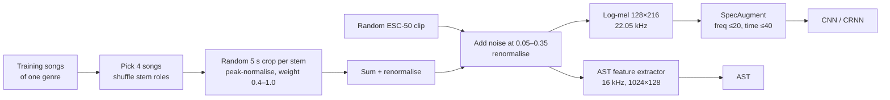

# Robust Music Genre Classification Under Distribution Shift

The training and test audio come from different distributions. Training data is clean, single-song instrument stems; test clips are mashups of stems from different songs of the same genre, with tempo shifts and ESC-50 environmental noise. This project classifies 10 genres under that shift. Simulating the test-time mashup process during training, then fine-tuning an AudioSet-pretrained Audio Spectrogram Transformer, raised Kaggle macro F1 from 0.358 (MFCC + logistic regression) to 0.890.

   [](https://huggingface.co/spaces/ghazi-r3/music-genre-classifier)

**Live demo:** the fine-tuned AST is deployed as a [Gradio app on Hugging Face Spaces](https://huggingface.co/spaces/ghazi-r3/music-genre-classifier). Upload any audio clip and it returns genre probabilities averaged over 5 random 5 s crops. The weights are published at [`ghazi-r3/messy-mashup-genre-classifier`](https://huggingface.co/ghazi-r3/messy-mashup-genre-classifier). The Space sleeps when idle, so the first request takes a minute to wake it.

## Results

| Model | Params | Val macro F1 | Kaggle macro F1 | Δ Kaggle F1 |
|---|---|---|---|---|
| Random baseline | – | – | 0.09420 | – |
| MFCC + logistic regression | 1.2K | –¹ | 0.35802 | +0.26382 |
| Scratch CNN | 2.45M | 0.840 | 0.80789 | +0.44987 |
| CRNN (CNN + BiGRU + attention) | 2.75M | 0.816 | 0.83917 | +0.03128 |
| AST, two-phase fine-tuning | 86.2M | 0.862 | 0.88965 | +0.05048 |

The largest jump (+0.450) came with the CNN, which introduced the full test-like mashup simulation (noise injection, random stem weighting) and a spectrogram model at the same time; no ablation separates the two.

<sub>Validation sets are simulated mashups built only from 15 held-out songs per genre, with 30 / 200 / 100 mashups per genre for CNN / CRNN / AST. ¹ The baseline notebook reports 0.714, but it splits mashups rather than songs, so validation shares songs with training. That number is not comparable and is omitted.</sub>

## The core problem: train/test distribution shift

**Training data:** 10 genres × 100 songs, each pre-separated into four stems (drums, bass, vocals, other).
**Test data:** 3,020 clips, each built by taking stems from *different* songs of one genre, adjusting tempo, and adding an ESC-50 environmental sound (dogs, rain, engines, …) at 0.05–0.35 relative amplitude.

A model trained on clean single songs never sees three things the test set is made of: instruments from unrelated recordings playing together, arbitrary balance between those instruments, and loud non-musical noise.

**The fix is to rebuild the test set's construction process inside the training loop.** Every training example is a freshly synthesised mashup (see [`src/preprocessing.py`](src/preprocessing.py)):

1. Sample **4 songs** from one genre (training songs only).
2. **Shuffle stem roles**, so which song supplies the drums, bass, vocals or other part is random.
3. Take a random 5 s window of each stem, **peak-normalise it, and weight it by U(0.4, 1.0)** to vary instrument balance.
4. Sum and renormalise, then **add a random ESC-50 clip at U(0.05, 0.35)**, the test set's noise range.

Each run generates 6–12 mashups per training song (5,100–10,200 examples), each one a new random combination. Validation is split by **song**, not by mashup, so no validation stem is ever heard in training.



Two gaps remain between this simulation and the test recipe. Songs are drawn with replacement, so about 7% of mashups reuse a song. Tempo shifts are not simulated.

## Architecture progression

### 1. Random baseline: 0.09420
A uniform random genre for every clip. It sets the chance floor (0.10 for 10 balanced classes) and confirms the submission pipeline end to end.

### 2. MFCC + logistic regression: 0.35802 (+0.264)
Sixty MFCCs per clip, summarised by mean and standard deviation over time (a 120-d vector), fed to a class-balanced logistic regression. It was trained on 600 cross-song mashups, but those mashups had no noise and fixed stem gains. It shows that timbre alone carries genre signal. Its limits are that averaging over the whole clip discards rhythm, the training data did not resemble the noisy test clips, and the solver had not converged after 3,000 iterations.

### 3. Scratch CNN: 0.80789 (+0.450)
Five double-convolution blocks (32 → 256 channels) over a 128 × 216 log-mel image, global average pooling, and a two-layer MLP head with dropout 0.4/0.2. It was trained for 30 epochs with AdamW, cosine decay and label smoothing 0.1, and predicts by averaging 10 random crops per clip. This is where the full mashup simulation and SpecAugment were introduced, and the score more than doubled. Its limit is that global average pooling discards temporal order: the model knows *which* spectral patterns occur, not *when*.

### 4. CRNN: 0.83917 (+0.031)
It uses the same convolutional backbone, but pools only over frequency. That leaves a sequence of 13 time steps × 256 features, read by a bidirectional GRU (128 units per direction) and combined by learned attention pooling rather than taking the last state. Modelling how patterns evolve over time added 0.031 on the leaderboard. But validation pointed the other way (0.816 vs the CNN's 0.840) and swung between 0.26 and 0.82 across epochs, so this gain could not have been chosen from validation alone.

### 5. Audio Spectrogram Transformer: 0.88965 (+0.050)
This is the AudioSet-pretrained AST (`MIT/ast-finetuned-audioset-10-10-0.4593`: 12 transformer layers over 16 × 16 spectrogram patches), with its 527-class head replaced by a 10-class head. Fine-tuning runs in two phases:

- **Phase 1, head only:** the encoder is frozen and only the head (9,226 parameters) trains, for 3 epochs at lr 1e-3.
- **Phase 2, full model:** everything is unfrozen and trained for 2 epochs at lr 5e-5, 20× lower.

The order matters because the new head starts random. Its early gradients are large and carry no genre information, and if the encoder were trainable at that point those gradients would overwrite pretrained AudioSet features before the head had learned anything (catastrophic forgetting). Training the head first means that when the encoder unfreezes, its gradients already reflect genre, and the small learning rate adjusts features rather than replacing them. In the run, validation F1 rose 0.826 → 0.835 → 0.852 during phase 1. It dipped to 0.806 on the first full fine-tuning epoch and finished at 0.862. Its limit is that it was trained for only 5 epochs on 5 s clips.

## Reproducing

This needs the Messy Mashup competition data (`genres_stems/`, `ESC-50-master/`, `mashups/`, `test.csv`), which is not redistributed here. With that in one folder:

```bash
pip install -r requirements.txt
python -m src.train --model ast --data-root /path/to/messy_mashup
python -m src.inference --checkpoint checkpoints/ast.pt --data-root /path/to/messy_mashup --out submission.csv
```

On the original single Tesla T4, the run took about 7 minutes to precompute features, 103 minutes to train and 37 minutes to run inference with TTA. The precomputed AST features need about 4 GB of RAM. Training mashups are random, so expect scores near the table rather than identical to it. `make test` runs the unit tests without any data, and `make train-all` / `make evaluate` cover all models.

## Repository structure

```
src/
  config.py          every hyperparameter, one dataclass per model
  preprocessing.py   mashup simulation, noise injection, log-mel / MFCC, SpecAugment
  dataset.py         song-level split, example generation, Dataset classes
  engine.py          shared train / evaluate loop
  models/            baseline.py, cnn.py, crnn.py, ast_finetune.py
  train.py           python -m src.train --model {baseline,cnn,crnn,ast}
  inference.py       batch prediction with test-time augmentation
  evaluate.py        rebuilds the results table from checkpoints
notebooks/           the five original experiments, with their outputs
tests/               model shapes and sizes, AST freezing, augmentation pipeline
```

## What I would do differently

1. **I never ensembled.** I trained three different deep model families and submitted each one alone. Averaging their softmax outputs takes a few lines of code and is the cheapest gain I left untested.
2. **My validation set did not predict the leaderboard.** Validation ranked the CNN above the CRNN (0.840 vs 0.816), and the leaderboard ranked them the other way (0.808 vs 0.839). The AST scored 0.028 higher on the leaderboard than on validation. Validation came from only 15 held-out songs per genre and had no tempo shifts, so it was itself shifted from the test set, which is the exact problem this project is about. A larger validation set that matched the test recipe should have come before any model comparison.
3. **There was no ablation.** The CNN step changed the model and the data simulation at once, so I cannot say how much of the +0.450 came from noise injection, stem weighting, role shuffling or the architecture. Removing one component per run would have answered it.
4. **The AST was under-trained, and half of every input was padding.** It got 5 epochs in total, because one full fine-tuning epoch took 34 minutes on a T4. A 5 s clip fills about 498 of AST's 1,024 input frames, and the rest is padding, so longer crops would have used capacity that was already paid for.
5. **Training ignored most of every song.** Stems are decoded for only their first 7 seconds before a 5 s crop is taken, so the remainder of each track never appeared in training. Tempo shifts, a documented part of the test recipe, were never simulated.
